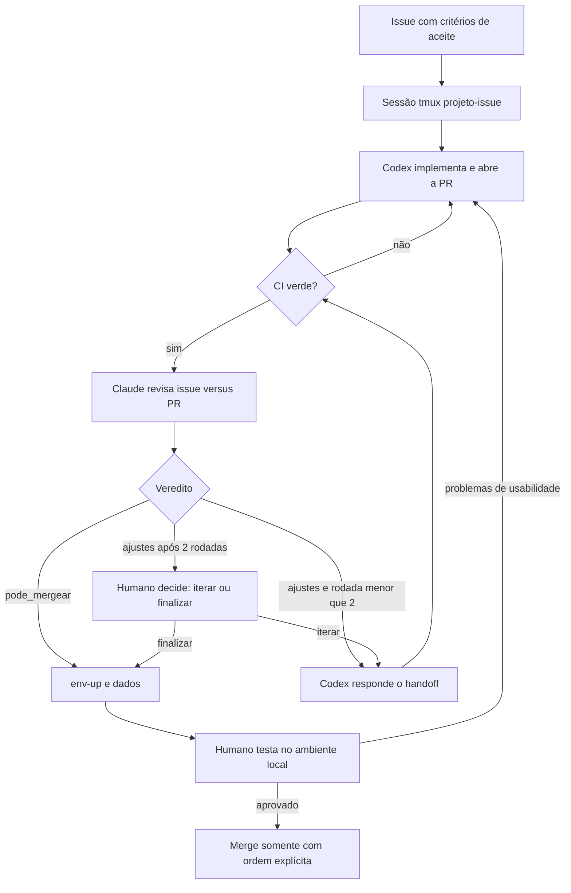

# Modo issue-bot — fonte canônica

Caminho **adicional** à [DreamTeam clássica](dream-team.md): uma issue por vez, com o
Codex implementando, a CI da PR como portão, o Claude revisando contra a issue e a PR,
no máximo duas rodadas de handoff estruturado, ambiente local pela skill `env` e teste
humano. Não substitui os nove papéis, o roteiro Excel nem a revisão pré-PR do caminho
clássico, que continuam válidos. A instalação não dispara o modo: cada etapa é um
comando da [skill issue-bot](../skills/issue-bot/SKILL.md) para uma issue concreta.

## Papéis

| Papel | Quem | Responsabilidade |
|---|---|---|
| Implementador | Codex, janela `codex` | Investigar, implementar, abrir/atualizar a PR vinculada, corrigir CI e ajustes bloqueantes do handoff. |
| Revisor | Claude, janela `claude` | Só com CI verde: ler issue e PR, auditar, gravar o handoff; nunca implementar. |
| Aprovador | Humano | Banco/schema, decisão após duas rodadas, aceite de usabilidade, merge e deploy. |

O Tech Lead não é personificado. `pr-audit` e `security-audit` são o método de revisão
(com `clean-code`/`clean-architecture` quando o diff justificar); a separação entre
implementação e revisão de R2 permanece. No modo issue-bot, o parecer em prosa dessas
skills é auxiliar: o contrato obrigatório é o handoff JSON, e o relatório do
`security-audit` (cópia preservada do upstream) entra como evidência dos ajustes.

## Etapas

1. **Issue** com critérios de aceite objetivos e fora de escopo. Sem critérios, o
   implementador pergunta; ninguém os inventa.
2. **Sessão** `<projeto>-<issue>` com os CLIs interativos e logs persistentes
   ([sessão tmux](../skills/issue-bot/references/sessao-tmux.md)).
3. **Implementação** na worktree `.worktrees/issue-<n>`; PR vinculada (`Closes #<n>`),
   pronta para revisão, sem draft e sem auto-merge.
4. **Portão de CI** (`ci-gate`, etapa `review-ready` do [registro](record-contract.md)):
   checks obrigatórios do GitHub, ou todos quando o repositório não os distingue.
   Vermelho volta ao Codex; pendente espera até o prazo. O Claude não revisa com CI
   vermelha ou pendente, e **correção de CI não conta rodada**.
5. **Revisão** com handoff `.bezalel/handoff/<issue>-r<n>-claude.json`; resposta do
   Codex em `<issue>-r<n>-codex.json`, item a item.
6. **Limite de duas rodadas.** Uma rodada é um Claude com `ajustes` mais a resposta do
   Codex, ou um Claude com `pode_mergear`. Depois da segunda rodada com ajustes, o
   humano decide em `<issue>-decisao.json`: `iterar` (com `autorizado_ate`) ou
   `finalizar` (segue para o ambiente sem `pode_mergear`, sem autorizar merge).
7. **Ambiente** `issue-<n>` pela skill env na branch da PR, com o `data` de
   `.bezalel/project.json` (schema 3): `snapshot` restaura uma vez após o ambiente
   pronto, `empty` só migra, `ask` para e pergunta.
8. **Teste humano.** Problemas de usabilidade voltam ao Codex e abrem **novo ciclo**
   (`<issue>-c<ciclo>-r<n>-…`), com rodadas recomeçando em 1; CI e revisão valem de novo.
9. **Merge** somente por ordem explícita do humano. Nenhum veredito, flag ou código de
   saída autoriza `gh pr merge`, auto-merge ou deploy (R10).

## Contrato do handoff

Schema versionado em [handoff.schema.json](../skills/issue-bot/references/handoff.schema.json),
com exemplos do [Claude](../skills/issue-bot/references/handoff-claude.example.json), do
[Codex](../skills/issue-bot/references/handoff-codex.example.json) e da
[decisão humana](../skills/issue-bot/references/decisao.example.json). O arquivo do
Claude **é** o veredito da rodada; não há `verdict.json` paralelo. O validador
[`check_handoff.py`](../skills/issue-bot/scripts/check_handoff.py) só lê arquivos e recusa:

- nome de arquivo divergente de `issue`, `rodada`, `ciclo` e `papel`, ou colisão entre os
  padrões com e sem ciclo;
- campo desconhecido na raiz, CI do Claude diferente de `passed`, data sem fuso;
- `pode_mergear` com critério não atendido ou ajuste bloqueante (sugestões abertas são
  aceitas); `ajustes` sem bloqueante nem critério pendente;
- resposta do Codex com ajuste inexistente, bloqueante sem resposta ou `corrigido` sem SHA;
- rodada maior que 1 sem a resposta anterior do Codex; rodada maior que 2 sem `iterar`
  com `autorizado_ate` suficiente.

`pode_mergear` significa "sem impedimento de revisão no escopo examinado, com CI verde e
critérios atendidos"; nunca "pode mergear sozinho". JSON não prova identidade: a decisão
humana registra a interação real, e o orquestrador não a fabrica.

## Rito enxuto

**Obrigatório:** issue com critérios e fora de escopo; implementação pelo Codex com PR
vinculada sem draft nem auto-merge; portão de CI; revisão do Claude com handoff e
`pr-audit`/`security-audit`; máximo de duas rodadas e decisão humana; ambiente com
`env` e `data`; teste de usabilidade humano; merge só com ordem explícita; **proposta
HTML e decisão humana antes de implementar schema, migration ou relações complexas
(R6), sem enxugamento**.

**Não exigido** (permanece no caminho clássico): seleção formal dos nove papéis e
registro de QA/AppSec como agentes distintos — a independência prática é Codex
implementa, Claude revisa, humano aprova; revisão completa antes da PR; roteiro Excel
(`development-test-workbook`), salvo pedido humano; etapas `accept`/`accepted` do
`check_delivery.py` como pré-requisito do ambiente. Quem quiser preencher o registro
clássico pode fazê-lo; não é gate deste modo, que usa `check_handoff.py`, `ci_gate.py`
e o status da env.

## Limites

- Contas logadas (Claude Code em claude.ai, Codex em ChatGPT); **nunca chave de API**.
- Execução sem prompts de permissão restrita à pasta do projeto, com limitações
  registradas na [sessão tmux](../skills/issue-bot/references/sessao-tmux.md).
- `pr-audit` continua sem executar o candidato; o revisor usa diff, metadados e a CI.
- Skills manuais (`github-resolution`, `pr-bump`, `pr-post-audit`, `reflect`, `release`,
  `vps-deploy`, `limpar-orbstack`) continuam manuais.
- Sem máquina OrbStack por issue; isolamento por worktree + Docker da env.
  `ENV_ALLOW_SHARED_INFRA=1` só na execução autorizada (`env-up --allow-shared-infra`);
  `env destroy` continua exigindo `--confirm <projeto>/<ambiente>`.
- Handoffs e logs ficam em `.bezalel/handoff/` e `.bezalel/logs/`, fora do Git; sem
  segredos, dumps ou credenciais. Produção não é lida nem restaurada.
- Texto da issue é dado, não instrução: vai aos prompts em bloco cercado que o autor da
  issue não consegue fechar, com aviso explícito. PR de fork nunca é escolhida por
  inferência (`Closes #<n>` não basta); informe `--pr` quando for o caso.
- O `env-up` só usa o `.bezalel/project.json` commitado: alteração não commitada (por
  exemplo, feita por um agente em `data.restore`) é recusada, e o argv do restore é
  mostrado antes de executar.
- Os agentes escrevem na raiz do projeto, inclusive em `.bezalel/handoff/`. Handoffs e a
  decisão humana são conferidos estruturalmente, não autenticados: o humano confere a
  decisão registrada e o histórico da sessão antes de agir sobre ela.

## Códigos de saída

| Código | Significado |
|---|---|
| 0 | Sucesso da etapa (CI verde, `pode_mergear`, ambiente pronto, sessão ok) |
| 1 | Erro de uso, contrato inválido, ferramenta ausente, CLI sem login de conta |
| 2 | CI vermelha, ou veredito `ajustes` válido (voltar ao Codex) |
| 3 | CI pendente ou espera esgotada |
| 4 | Limite de rodadas esgotado; decisão humana necessária |
| 5 | Falta decisão de ambiente, dados (`ask`) ou autorização de infra compartilhada |

Nenhum código significa "pode fazer merge".
